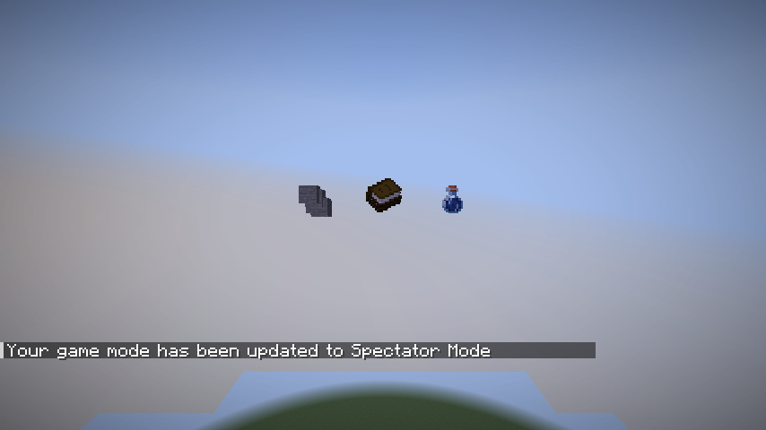
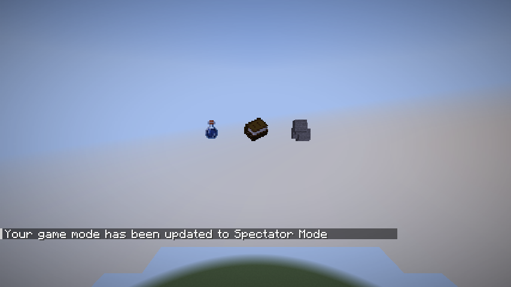

# Validierung des Releases 1.0.0+1.21.11

Geprüft am 17. Oktober 2026 mit Minecraft 1.21.11, Fabric Loader 0.20.0,
Fabric API 0.141.6+1.21.11, Loom 1.14.10, Gradle 9.2.1 und JDK 21.

## Erfolgreiche Prüfungen

- `./gradlew genSources`: offizielle Mappings und dekompilierte Quellen verfügbar.
- `./gradlew build compileGametestJava`: erfolgreich; normale JUnit-Tests sind nicht vorhanden (`test NO-SOURCE`).
- `./gradlew build runClientGameTest`: erfolgreich, ein tatsächlich ausgeführter Fabric-Client-GameTest mit mehreren Modell-/Konfigurationsassertionen und integrierter Testwelt.
- Wiederholbares Cloud-Installationsskript ausgeführt: Build und Testkompilierung erfolgreich.
- Release-Metadaten geprüft: clientseitig, exakte Minecraft-Version, keine GameTest-Klassen in der Release-JAR.

Die Modellprüfungen liefen gegen echte, aufgelöste Vanilla-Modelle:

| Item | Vanilla-Quads | Optimierte Quads |
| --- | ---: | ---: |
| Trank | 144 | 2 |
| Enderperle | 54 | 1 |
| Buch | 64 | 1 |
| Verzaubertes Buch | 64 | 1 |

Zusätzlich bestanden: Mod deaktivieren, Seiten wiederherstellen, 3D-Opt-in/Opt-out
mit Stein, unveränderter Sonderrenderer für Truhen, leere Stacks, Schattenradius
und Schattenstücke abschalten, Whitelist/Blacklist sowie ein Stack mit
CustomModelData-Komponente und erzwungenem Glint. Letzteres prüft den Vanilla-
Fallback ohne spezielles Ressourcenpaket; beliebige CustomModelData-Pakete sind
dadurch nicht pauschal getestet.

Die beiden Screenshots wurden nach der finalen Rotationskorrektur erzeugt und
visuell geprüft: Trank, Buch und Stein sind von beiden Kamerapositionen sichtbar.
Der Test zählt nicht nur entfernte Quads, sondern lässt die Entities auch im
Minecraft-Client zeichnen.

## Grenzen der Aussage

Der Client lief auf einem virtuellen Xorg-Bildschirm mit Software-OpenGL.
Warnungen zu fehlendem Audiogerät, optionalen Online-Profildiensten und einer
fehlenden X11-Cursorform traten auf; der Client-Test schloss trotzdem erfolgreich
ab. Es wurden weder Online-Login noch Hardware-GPU-Performance validiert.

Keine FPS-Messreihe, kein Iris-/Sodium-/Shader-Kompatibilitätstest und keine
NeoForge-Variante. Unterschiedliche Ressourcenpakete und andere Item-Renderer
benötigen zusätzliche Tests. Weniger Quads belegen eine Geometriereduktion,
aber keine bestimmte FPS-Steigerung.
